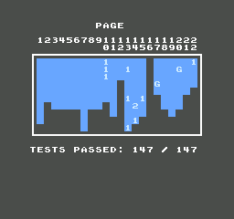
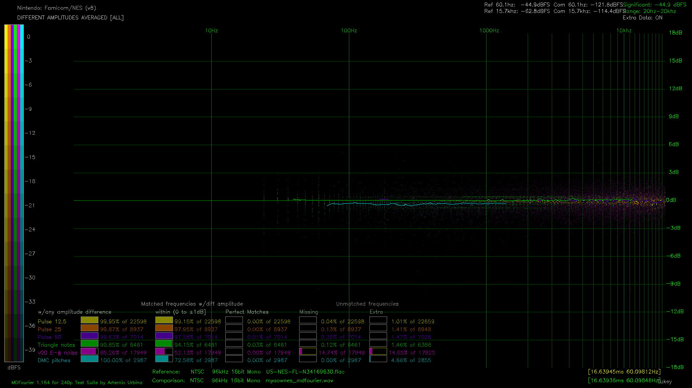

# MyaowNES - NES Emulator

NES emulator written in C, aimed at cycle-accuracy and passing tests.

- [Play MyaowNES online](https://makryl.github.io/myaownes/)
- [Download release](https://github.com/makryl/myaownes/releases) (Linux x64, Windows x64, MacOS, Android, WebAssembly)
- [Zlib license](LICENSE.txt)

This project was started for educational purposes, to learn bytecode and assembly,
but at some point I just couldn't stop trying to pass every test rom I could find.

Emulator has SDL3 frontend, and the core library can be built independently.
I tried to keep code straightforward and compact,
but while the core library code was written carefully, frontend (main.c) is a bit of a mess.

It passing more than 300 test roms ([log.txt](tests/log.txt), [screenshots](tests/screenshots/)), but still lacks manual testing and may contain simple bugs.
Supports far from all, but many mappers: 44 discrete, MMC1-4 and partially MMC5, 36 others. While they passes all tests i found, many of mappers were tested simply by launching some game, and some discrete mappers were not tested at all.

[](tests/screenshots/AccuracyCoin/AccuracyCoin.nes.2.png)
[](tests/DA__ALL_AVG_US-NES-FL-N34169630_vs_myaownes_mdfourier_0000.png)

## Embed ROM in WebAssembly build

You can embed your game in emulator's web build, so game will run immediately after page loads. In this mode emulator hides some UI, so users can't change rom file.

Use [online tool](https://makryl.github.io/myaownes/embed.html) or script for offline usage.

Next instructions for offline script.
Download WebAssembly build from [releases](https://github.com/makryl/myaownes/releases), and use `embed.js` script included in archive.
You will need [Node.js](https://github.com/nodejs/node) to run this script.

```
node embed.js --nes <path/to/game.nes> [optional arguments]
```

Optional arguments:

- `--out <path/to/game.html>`
- `--template <path/to/index.html>`
- `--config <path/to/config.txt>`
- `--palette <path/to/palette.pal>`
- `--title <title>`
- `--desc <desc>`

## Build

For some platforms [SDL3 dependencies](https://github.com/libsdl-org/SDL/tree/main/docs) required.
For WebAssembly you need to install [Emscripten SDK](https://github.com/emscripten-core/emsdk).
For better performance PGO should be used.
Project uses Github Actions, so you can view examples of how to install dependencies and build code with PGO for different platforms in [build.yml](.github/workflows/build.yml).

Clone project with submodules using `git`.

```
git clone --recurse-submodules https://github.com/makryl/myaownes.git
```

Use `cmake` to configure and build project, it has several presets for different platforms.

```
cmake --preset Linux-Release
cmake --build build/Linux-Release --target install
```

## References

Almost all information I got from next sites, source code of tests and other emulators:

- [nesdev.org](https://www.nesdev.org/)
- [dendy.migera.ru](http://dendy.migera.ru/)
- [nes-test-roms](https://github.com/christopherpow/nes-test-roms), my [fork](https://github.com/makryl/nes-test-roms) with more tests from forums
- [MesenTests](https://github.com/nesdev-org/MesenTests)
- [AccuracyCoin](https://github.com/100thCoin/AccuracyCoin)
- [nes-audio-tests](https://github.com/bbbradsmith/nes-audio-tests)
- [little-things-nes](https://github.com/pinobatch/little-things-nes)
- [Bisqwit's NES emulator](https://bisqwit.iki.fi/source/nes.html) - very compact and easy to learn, but incomplete
- [QuickNES](https://github.com/libretro/QuickNES_Core)
- [MesenCE](https://github.com/nesdev-org/MesenCE)

## TODO

Some ideas and reminders for future:

- QoL embed mode:
  - custom font and touch control icons
  - allow separate files build mode
- Review performance
- Extra audio in mappers
- More homebrew mappers
- Network play
- Embeded roms and saves manager
- Zapper
- NSF player mode
- Fake stereo
- Wide screen
- No sprite limit
- Slowdown
- Rewind
- CRT shader
- App icons
- More tests:
  - https://www.nesdev.org/wiki/Emulator_tests
    - mmc5test_v2, mmc5ramsize
    - zapper
    - allpads
  - https://github.com/nesdev-org/MesenTests/tree/main/NES
    - sprite_evaluation_test(2), sprite_evaluation_test
  - https://github.com/bbbradsmith/nes-audio-tests
  - https://github.com/pinobatch/little-things-nes

## License

This software distributed under Zlib license: [LICENSE.txt](LICENSE.txt).

Copyright (C) 2026-2026 Maksim Krylosov <aequiternus@gmail.com>
